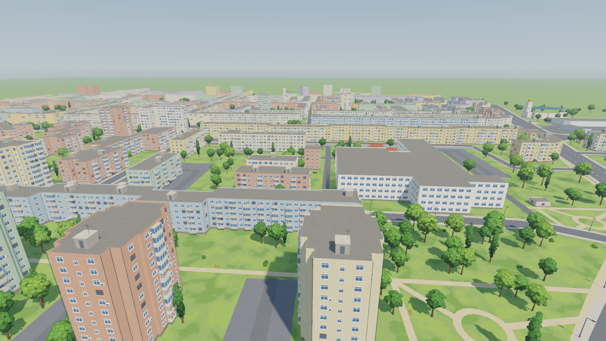
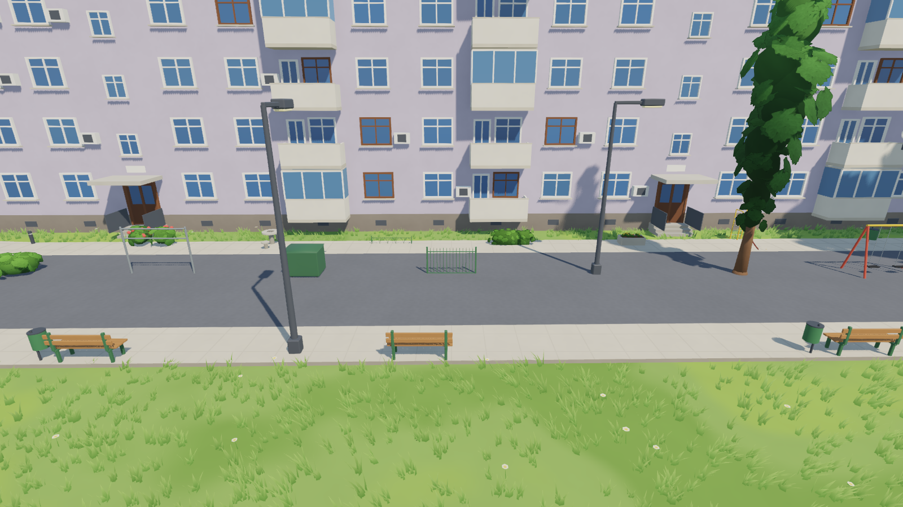
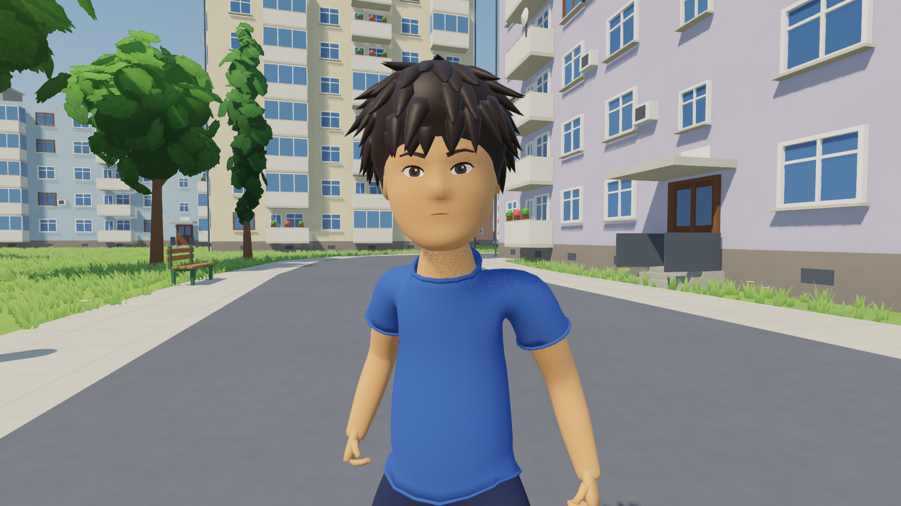
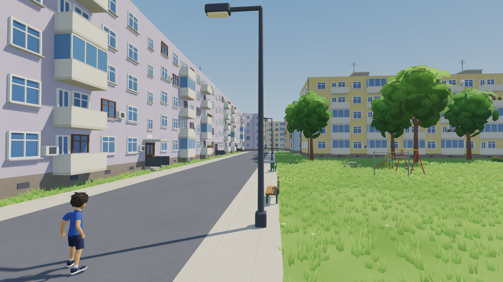

# Micro 15

A third-person exploration game (single player and co-op) set in a cartoon
version of Micro 15, the neighbourhood in Satu Mare, Romania. Mini-games may
use other camera styles later.



## Art direction

Stylized 3D in sunny mid-morning daylight, with no outlines: light and shadow
draw the forms. The rules (shape language, triangle budgets, material
families, palette, detail density and how to make new assets) are in
[docs/art_direction.md](docs/art_direction.md). In short:

* Soft direct light shared by every shader (`shaders/soft_light.gdshaderinc`:
  slightly wrapped Lambert plus a broad highlight), soft sun shadows, sky
  ambient with a neutral fill, SSAO for contact shadows, Filmic tonemapping,
  light haze. No bloom, no colour grading. SMAA plus 2× MSAA.
* Every imported material is matched by name to a family
  (`scripts/material_library.gd`: plaster, concrete, asphalt, paving, painted
  metal, wood, glass, foliage...) that sets its roughness, specular and
  restrained surface variation (large-scale mottling, paving seams, a darker
  band at the foot of walls), and a coordinated palette of muted pastels
  replaces the raw model colours.
* Trees, bushes and hedges are balls of leaf cards around small dark cores
  with normals bent outwards (`blender/foliage.py`). Each card shows a
  painted patch of hanging leaves (`game/style/leaf_*.png`, made by
  `tools/make_leaf_texture.py`), cut out with alpha so crowns have leafy,
  scalloped outlines; cards seen edge-on thin out instead of showing as
  streaks. Spruces are drooping, faceted tiers; benches and lamps have
  chunky, chamfered parts.
* A day cycle (`scripts/sun_cycle.gd`, the `SunCycle` node) moves the sun
  along its real path over Satu Mare for the local clock time and colours
  the sunlight, sky, ambient light and haze to match: warm and low in the
  morning and evening, a soft blue moonlight at night. It starts paused at
  12:00 (the usual look); the admin tool changes the time or runs the
  clock.

## Playing (`game/`, Godot 4.7)

Open `game/` in Godot 4.7 and press F5.

| Key | Action |
| --- | --- |
| WASD, mouse | move, look |
| Shift | run |
| Space | jump; again in the air for a double jump (a flip) |
| Ctrl or C | crouch (hold) |
| Left click or F | punch: a jab, then a cross if pressed again quickly |
| Esc | free the mouse |

Running with `-- --shots` saves preview renders to `docs/renders/` and quits;
`-- --selftest` walks, runs, crouches, jumps, double-jumps, punches and
flies the player on its own and prints which animation played when.

## The editor project

Everything is a real scene that opens and can be edited in the Godot editor:

* `levels/micro15/micro15.tscn`: the level, as nodes. `WorldEnvironment`
  (`style/world_environment.tres`) and `Sun`; `Ground` and `Buildings`
  (the glTF scenes, styled by `scripts/styled_model.gd`, in the editor
  too); `Details` and `Props` (`scripts/scatter.gd`: the repeated windows,
  balconies, trees and lamps drawn with MultiMeshes, visible in the editor);
  `Grass`; invisible `Bounds`; `Placed` (things placed with the admin tool,
  `levels/micro15/placed.tscn`); `InkOutline` (`style/ink_outline.tres`,
  hidden; the admin tool shows it for comparison); and
  the `Player`.
* `player/player.tscn`: collision capsule, the boy (`characters/kid/kid.glb`)
  and the camera on a spring arm; `scripts/player.gd` drives it. Inputs are
  in Project Settings → Input Map.
* `assets/*.tscn`: one scene per placeable thing, with collision. Drag them
  into a level in the editor, or place them in game with the admin tool.

### Admin and modding tool (`scripts/admin.gd`)

Only there when the game runs from the Godot editor (never in exported
builds). F1 opens the admin bar:

| Key | Action |
| --- | --- |
| B | build mode: pick an asset from the list, left click places it, wheel or Q/E turns it, Shift+wheel or Z/X scales it, G snaps to a 0.5 m grid, Delete removes the thing under the mouse (placed, or a map tree, bush, lamp or bench), middle click copies it, Ctrl+Z undoes; hold the right mouse button to look around |
| B, then **[ remove tool ]** | left click removes what is under the mouse: things you placed, or the map's trees, poplars, bushes, lamps and benches (a red ring shows its reach); Ctrl+Z puts it back |
| B, then **[ grass brush ]** | hold left to grow 3D grass, Shift+left to clear it, wheel or Z/X for the brush size (the ring); Ctrl+Z undoes a whole stroke |
| N | noclip: fly through everything (Space up, Ctrl down, Shift fast) |
| T | teleport to the point under the mouse (or the screen centre) |
| [ ] | movement speed down / up |
| , . | time of day back / on by half an hour (moves the sun) |
| / | day cycle running / stopped (Shift+, . makes a day slower / faster; default 24 minutes) |
| F2 / F3 | old ink lines (silhouettes only, for comparison) / 3D grass on or off |
| F12 | screenshot to `screenshots/` |

Every change is saved straight to the level's `placed.tscn`, so placed
things are part of the level and show up as normal nodes in the editor.
Map props you remove are listed in `levels/micro15/removed_props.json` and
painted grass in `levels/micro15/grass_paint.json` (brush strokes drawn
over `grass_mask.png`); both are read when the level loads, and deleting a
file undoes all of its changes.

### Placeable assets (`game/assets/`)



The map's trees, poplars, bushes, lamps and bench, plus a street kit made by
`blender/build_assets.py` (`assets/source/street_kit.glb`): painted metal
fence, knee-high lawn hoop fence, park bench, street bin, the big green
waste container, the carpet beating frame, swing, slide, concrete chess
table, bollard, bike rack, concrete planter, box hedge, blue spruce and
birch. `tools/make_assets.gd` turns every model into a scene:

```
godot --headless --path game --script res://tools/make_assets.gd
```

## Playable character (`game/characters/kid/`)



The boy from [the character sheet](docs/character_sheet.png), about 1.5 m
tall, built by `blender/build_character.py` in layers, like a character with
an outfit system:

- **Base body**: one smooth, watertight mesh (Skin modifier + subdivision)
  skinned to a 26-bone rig (root, hips, 3-bone spine, neck, head, shoulders,
  arms, hands, fingers, thighs, shins, feet, toes and three hair bones) with
  automatic weights. It is exported in pieces (`body_torso_upper`,
  `body_pelvis`, `body_upper_arms`, `body_thighs`, `body_ankles`,
  `body_feet`... and `body_base`) whose seams match exactly.
- **Head, face, hair, hands**: smooth separate meshes; spiky hair made of a
  cap plus ~120 pointed locks weighted to the hair bones.
- **Garments** (`garment_shirt`, `garment_shorts`, `garment_socks`,
  `garment_shoes`): separate meshes, each modelled from its own stick figure,
  cut open at the hems, given thickness and rolled edges, fitted to stay
  clear of the body and of the garments underneath, and skinned with weights
  taken from the body surface under them.

`kid.json` lists the garments, the body pieces each one hides, the default
outfit, the spring (hair) bones and the gait speeds. In the game
`player.wear([...])` shows a set of garments and hides the body pieces they
cover, so no skin can poke through clothes and new outfits or accessories
can be added later without touching the body.

Animations come from Quaternius' [Universal Animation Library](https://quaternius.com/packs/universalanimationlibrary.html)
1 and 2 (CC0), animated for game characters, retargeted onto the boy by
`blender/retarget_ual.py`: each bone follows the source bone's motion from a
rest pose lined up with the source's, the hips move by the source's motion
scaled to his leg length, and every clip is set on the ground. Clips: `idle`,
`walk`, `run` (sprint), `jump`, `fall`, `land`, `double_jump` (a mid-air
flip), `crouch_idle`, `crouch_walk`, `punch_jab`, `punch_cross` and `hit`.
`python tools/get_animations.py` downloads the libraries.

`scripts/player.gd` plays them: walk, run and crouch-walk sped up to match
the ground speed (feet don't slide) and switched at the same point of the
stride, leaning into turns and speed changes, hair bouncing on
`SpringBoneSimulator3D`, jump, double jump, fall and landing, a crouch that
lowers the collision capsule (and waits for room to stand up), a jab–cross
punch combo, and `take_hit()` for a hit reaction. Its materials (`CH_*`) go
through the same material library as the world (skin, hair, cloth, eye).

```python
import sys; sys.path.insert(0, r"<repo>/blender")
import build_character; build_character.run(r"<repo>")
build_character.preview(r"<repo>")      # optional: turnaround renders in renders/kid/
```

## The whole map (`game/levels/micro15/`)



The main scene, `levels/micro15/micro15.tscn`, is the whole neighbourhood
(about 1.24 km × 1.17 km) in full 3D, built by `blender/build_map.py` from
the OpenStreetMap extract with the same modelling rules as the corner below:
343 buildings (blocks of flats, P+10 towers, houses, garages, schools, the
hospital, churches with towers and onion domes, shops with shop fronts), all
roads with raised sidewalks, about 2,400 trees and poplars, 500 bushes, 545 lamps
and 157 benches.

* Buildings are exported as light shells (`buildings.glb`). Their ~140,000
  repeated details (windows, balcony doors, open and enclosed balconies,
  entrances, curtains, AC units, dishes, pots, drainpipes, roof huts,
  antennas, vents, garage doors, shop fronts) are modelled once in
  `details.glb` and placed from `details.json`. Godot draws each type with a
  MultiMesh per 96 m cell, and small details stop drawing beyond 120–450 m.
* Trees and street furniture work the same way (`props.glb`, `props.json`).
* 3D grass is built in chunks around the camera as you walk and freed behind
  you (`scripts/grass_field.gd`, mask from `tools/make_grass_mask.py`).
* Buildings, kerbs, tree trunks and lamp posts are solid; invisible walls
  keep the player inside the mapped area. The map loads in under a second.

Rebuild it from Blender's Python console, then regenerate the grass mask:

```python
import sys; sys.path.insert(0, r"<repo>/blender")
import build_map; build_map.run(r"<repo>")      # or part="buildings" / "ground" / "details" / "props"
```

```
python tools/make_grass_mask.py
```

`props` reads the tree, bush, lamp and bench positions from
`blender/micro15_world.blend`, so run it with that file open.

## 3D corner test (`game/levels/corner/`)


A walkable, fully 3D corner of Micro 15 (around Aleea Constelației and
Aleea Proiectantului) that sets the look for the whole map:

* `blender/build_corner_3d.py` models every block from its OSM footprint:
  recessed windows with frames, sills and curtains, open and enclosed
  balconies (some with flower pots or satellite dishes), stairwell entrances
  with canopies and steps, landing windows, plinths with basement vents,
  drainpipes, AC units, roof parapets, roof stair houses and antennas. Roads
  have raised sidewalks and kerbs. It also models stylised 3D trees,
  poplars, bushes, lamps and benches. Output: `game/levels/corner/*.glb`
  and `props.json`.
* `tools/make_grass_mask.py corner` marks where grass grows (`grass_mask.png`).
* `game/scripts/grass_field.gd` scatters real 3D grass blades and small
  flowers on the lawns (MultiMesh chunks, drawn up to 75 m from the camera,
  swaying in the wind).
* Shaders in `game/shaders/`: `stylized` (every made surface),
  `foliage` (leaf clusters: lighter on top, darker underneath, sway),
  `grass`, `lawn`, all lit by `soft_light.gdshaderinc`, and `ink_outline`
  (the old ink lines, now only an admin toggle).
* `game/levels/corner/corner.tscn` is the corner on its own (open it and
  press F6).

Rebuild the corner from Blender's Python console:

```python
import sys; sys.path.insert(0, r"<repo>/blender")
import build_corner_3d; build_corner_3d.run(r"<repo>")
```

## World (`blender/`)

| File | What it is |
| --- | --- |
| `blender/micro15_world.blend` | The world scene (Blender 5.2). |
| `blender/build_world.py` | Rebuilds the whole scene from OpenStreetMap data. |
| `reference/micro15_osm.json` | OpenStreetMap extract (700 m around the Micro 15 node). © OpenStreetMap contributors, ODbL. |

The map covers about 1.2 km × 1.2 km, 1 unit = 1 metre, +Y = north. It holds
roads with sidewalks and centre lines, footpaths and cycle lanes, parks,
playgrounds, sports pitches, parking lots, around 340 non-enterable buildings
(215 blocks of flats, houses, garages, schools, the hospital, two churches,
shops), about 2,900 trees and bushes, street lamps and benches. There are no
cars or people.

Buildings without a storey count in OSM get one from their footprint: compact
blocks become P+10 towers, long slabs become P+4. Each building object keeps
its `osm_id`, `kind` and `levels` as custom properties so it can be fixed by
hand.

### Rebuilding

In Blender's Python console (or the Blender MCP):

```python
import sys; sys.path.insert(0, r"<repo>/blender")
import build_world; build_world.build_all(r"<repo>")
```

Each stage (`stage_scene`, `stage_ground`, `stage_roads`,
`stage_buildings`, `stage_vegetation`, `stage_cameras`) can be rerun on its
own; it clears and rebuilds only its own collections.

### Notes for the game engine

* Materials are EEVEE node trees (Shader to RGB). Each material's viewport
  colour holds its flat colour, so an exporter or engine toon shader can use
  that.
* Outlines are Solidify modifiers named `Outline` (flipped, back-face culled
  shell using `M15_outline`). Apply or drop them on export, depending on how
  the engine draws outlines.
* Trees, lamps and benches share mesh data (instances) from the hidden
  `M15_Prototypes` collection.
