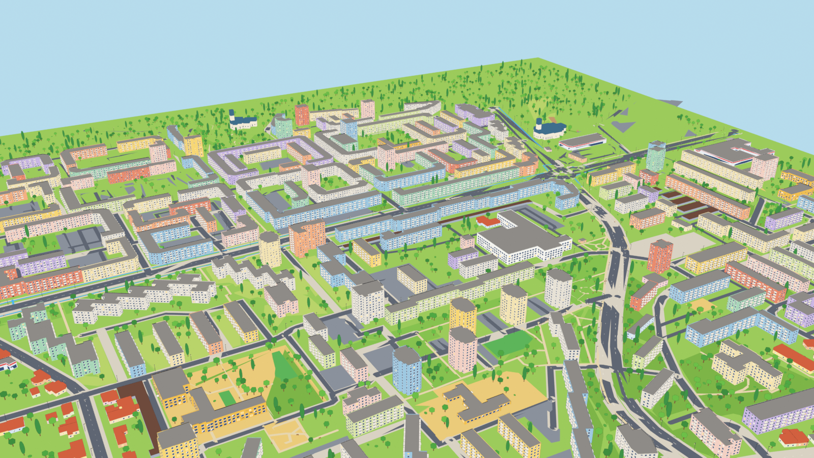
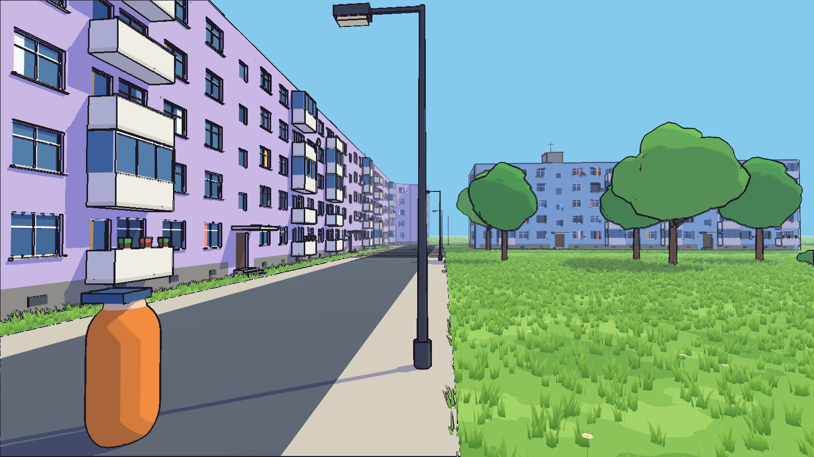

# Micro 15

A third-person exploration game (single player and co-op) set in a cartoon
version of Micro 15, the neighbourhood in Satu Mare, Romania. Mini-games may
use other camera styles later.



## Art direction

Flat "vector" look with bold dark outlines and saturated colours, in the
spirit of [the style reference](docs/style_reference.png): cel shading with
three hard light bands, no textures, inverted-hull outlines.

## Playable 3D corner (`game/`, Godot 4.7)



A walkable, fully 3D corner of Micro 15 (around Aleea Constelației and
Aleea Proiectantului) that sets the look for the whole map:

* `blender/build_corner_3d.py` models every block from its OSM footprint:
  recessed windows with frames, sills and curtains, open and enclosed
  balconies (some with flower pots or satellite dishes), stairwell entrances
  with canopies and steps, landing windows, plinths with basement vents,
  drainpipes, AC units, roof parapets, roof stair houses and antennas. Roads
  have raised sidewalks and kerbs. It also models stylised 3D trees,
  poplars, bushes, lamps and benches. Output: `game/levels/corner/*.glb`
  and `props.json`.
* `tools/make_grass_mask.py` marks where grass grows (`grass_mask.png`).
* `game/scripts/grass_field.gd` scatters real 3D grass blades and small
  flowers on the lawns (MultiMesh chunks, drawn up to 75 m from the camera,
  swaying in the wind).
* Shaders in `game/shaders/`: `toon` (three hard light bands),
  `foliage` (round shading on tree canopies, sway), `grass`, `lawn`, and
  `ink_outline` (ink lines on silhouettes and creases, fading with distance).
* `game/levels/corner/corner.tscn` is the main scene. Open `game/` in Godot
  and press F5: WASD to move, mouse to look, Shift to run, Space to jump. The
  orange capsule is a placeholder character. Running it with `-- --shots`
  saves the preview renders in `docs/renders/`.

Rebuild the corner from Blender's Python console:

```python
import sys; sys.path.insert(0, r"<repo>/blender")
import build_corner_3d; build_corner_3d.run(r"<repo>")
```

## World (`blender/`)

| File | What it is |
| --- | --- |
| `blender/micro15_world.blend` | The world scene (Blender 5.2). |
| `blender/build_world.py` | Rebuilds the whole scene from OpenStreetMap data. |
| `reference/micro15_osm.json` | OpenStreetMap extract (700 m around the Micro 15 node). © OpenStreetMap contributors, ODbL. |

The map covers about 1.2 km × 1.2 km, 1 unit = 1 metre, +Y = north. It holds
roads with sidewalks and centre lines, footpaths and cycle lanes, parks,
playgrounds, sports pitches, parking lots, around 340 non-enterable buildings
(215 blocks of flats, houses, garages, schools, the hospital, two churches,
shops), about 2,900 trees and bushes, street lamps and benches. There are no
cars or people.

Buildings without a storey count in OSM get one from their footprint: compact
blocks become P+10 towers, long slabs become P+4. Each building object keeps
its `osm_id`, `kind` and `levels` as custom properties so it can be fixed by
hand.

### Rebuilding

In Blender's Python console (or the Blender MCP):

```python
import sys; sys.path.insert(0, r"<repo>/blender")
import build_world; build_world.build_all(r"<repo>")
```

Each stage (`stage_scene`, `stage_ground`, `stage_roads`,
`stage_buildings`, `stage_vegetation`, `stage_cameras`) can be rerun on its
own; it clears and rebuilds only its own collections.

### Notes for the game engine

* Materials are EEVEE node trees (Shader to RGB). Each material's viewport
  colour holds its flat colour, so an exporter or engine toon shader can use
  that.
* Outlines are Solidify modifiers named `Outline` (flipped, back-face culled
  shell using `M15_outline`). Apply or drop them on export, depending on how
  the engine draws outlines.
* Trees, lamps and benches share mesh data (instances) from the hidden
  `M15_Prototypes` collection.
