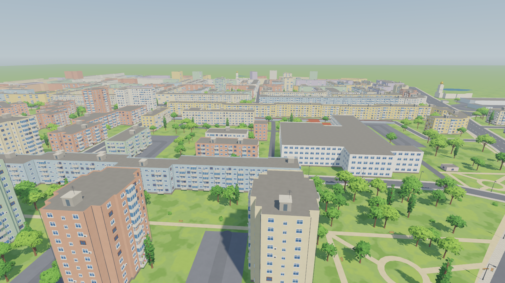

# Micro 15

A third-person exploration game, for single player and co-op, set in a
stylized 3D version of Micro 15, the neighbourhood in Satu Mare, Romania.
Mini-games may use other camera styles later.



## Playing

Open `game/` in Godot 4.7 and press F5.

| Key | Action |
| --- | --- |
| WASD, mouse | Move, look |
| Shift | Run |
| Space | Jump; press again in the air for a double jump (a flip) |
| Ctrl or C | Crouch (hold) |
| Left click or F | Punch: a jab, then a cross if pressed again quickly |
| Esc | Free the mouse |
| F1 | Map editor (only when run from the Godot editor) |
| F4 | Show the player's position |

Run options:

* `-- --shots` saves the preview screenshots to `docs/renders/` and quits.
* `-- --editor-shots` saves screenshots of the map editor.
* `-- --selftest` drives the player through every move and checks the map
  editor, the kerbs and the boundary, printing what happened.

## Documentation

| Page | What it covers |
| --- | --- |
| [The map](docs/map.md) | The playable area set by the corner pins, the boundary, how the map is built and rebuilt, and the corner test scene |
| [The editor](docs/editor.md) | The scenes in the Godot editor, the in-game map editor (F1), and the files it saves |
| [The assets](docs/assets.md) | Every placeable asset, and how to make new ones |
| [The character](docs/character.md) | The boy: body, garments, rig and animations |
| [The art direction](docs/art_direction.md) | The look: light, materials, palette, detail and the rules for new assets |
| [The Blender world](docs/blender_world.md) | The first Blender version of the whole neighbourhood |
| [What has changed](docs/changelog.md) | The history of the project |

## The repository

```
game/                    the Godot 4.7 project
  levels/micro15/        the main level: scene, built map, play area, your edits
  levels/corner/         the first 3D test corner
  assets/                placeable assets (scenes, meshes, the street kit source)
  characters/kid/        the playable boy
  player/                the player scene
  scripts/               game scripts; scripts/editor/ is the map editor
  shaders/, style/       shaders and shared materials
  tools/make_assets.gd   turns models into asset scenes
blender/                 Blender scripts that build the map, assets, trees and the boy
tools/                   Python tools: play area, grass mask, animation download
reference/               OpenStreetMap extract, the character sheet, the style reference
docs/                    documentation; docs/renders/ holds the screenshots by subject
```

## Rebuilding

The built files are in the repository, so the game runs without rebuilding.
To rebuild after changing a corner pin or a build script, see
[the map](docs/map.md#rebuilding), [the assets](docs/assets.md) and
[the character](docs/character.md). Blender 5.2 and Python 3 are needed.
They run in this order:

1. `python tools/make_play_area.py`
2. In Blender: `build_map.run(...)`, then `build_assets.run(...)` if the
   assets changed.
3. `python tools/make_grass_mask.py`
4. `godot --headless --path game --script res://tools/make_assets.gd`

## Credits

* Map data © OpenStreetMap contributors, ODbL.
* Animations: Quaternius'
  [Universal Animation Library](https://quaternius.com/packs/universalanimationlibrary.html)
  1 and 2 (CC0).
