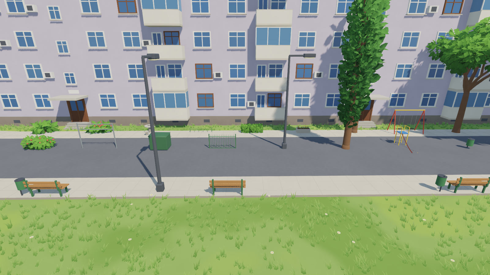

# Placeable assets (`game/assets/`)



Every placeable thing is a scene in `game/assets/`, with its mesh and
collision shape in `assets/meshes/`. The map editor's Place tool lists them
by category, and they can also be dragged into a level in the Godot editor.

| Category | Assets |
| --- | --- |
| Plants | broadleaf trees (`tree_a`, `tree_b`, `tree_c`), `poplar`, birch (`tree_birch`), blue spruce (`tree_pine`), bushes (`bush_a`, flowering `bush_b`), box `hedge`, concrete `planter` |
| Street | street `lamp`, park `bench`, wooden bench (`bench_wood`), `bollard`, litter bin (`trash_bin`), the big green `dumpster`, `bike_rack`, knee-high lawn hoop fence (`fence_low`), painted `fence_metal`, `bus_stop` (a shelter with a bench, glass side, STAȚIE fascia and the stop's sign), `recycling_bins` (paper, plastic and glass wheelie bins, labelled HÂRTIE, PLASTIC and STICLĂ), `electric_box` (a grey electricity cabinet with a warning sign), `utility_pole` (a concrete electricity pole with insulators, wires and a street light), `crossing_sign` (a pedestrian crossing sign on a striped pole), `hydrant`, `manhole` (a cast iron cover), `advert_column` (a round advertising column with posters), `picnic_table` |
| Shops | `kiosk` (a cream NON STOP booth with goods behind its windows, a serving hatch and a striped awning), `mini_market` (a one-storey shop with shelves behind big windows, a glass double door up two steps and a MINI MARKET sign), `shop_window` (a vitrine for the ground floor of a block, with goods, two dress forms, a MAGAZIN sign and an awning; its origin is at the back, so it stands against a wall), `drinks_fridge` (a red BĂUTURI RECI fridge with lit shelves of bottles), `ice_cream_freezer` (a chest freezer with tubs under sliding glass lids), `fruit_stand` (a market stall with crates of fruit under a canvas roof, with price cards), `terrace_table` (a café table with four chairs and a parasol) |
| Play | `slide` (ladder with handrails, railed platform and a deep chute), `swing`, carpet beating frame (`carpet_beater`), concrete `chess_table`, `clothes_dryer` (two T posts with washing lines and laundry), `sandbox` (with a bucket and spade), `seesaw`, `basketball_hoop`, `football_goal` |
| Building | `gas_pipe` (the yellow gas pipe along a block's plinth, with a valve and a meter box), `wall_sign` (a blue ALEEA MILCOV street plate), `block_number` (a BL. 15, SC. A plate), `wall_lamp` (a lamp over a stairwell door), and the building details of the map: windows, balconies, entrances, AC units, dishes, drainpipes and so on (`assets/details/`). The wall things have their back at the origin, so they stand flat against a wall. |

## Where they come from

* The trees, poplars, bushes, lamps and bench are the map's own
  (`levels/micro15/props.glb`, built by `blender/trees.py` and
  `blender/build_map.py`).
* Everything else is the street kit, modelled by `blender/build_assets.py`
  (`assets/source/street_kit.glb`). Shop signs are real 3D letters.
  Shop glass is drawn as light glare over the inside of the shop, since the
  stylized shader has no transparency.

`game/tools/make_assets.gd` turns every model into a scene with a mesh and
collision. Trees, lamps, poles, bollards, bins and the hydrant get a trunk
cylinder; the hedge, shops, fridges, cabinets and recycling bins are solid
boxes; bushes, the manhole cover and the wall things have none; everything
else gets its exact shape. Placed trees and bushes switch to the map's
lighter far versions past 70 m, and small things stop drawing sooner than
big ones (from 120 m for a bollard to 500 m for a tree or a shop), so a
street full of placed things stays quick to draw:

```python
# Blender's Python console
import sys; sys.path.insert(0, r"<repo>/blender")
import build_assets; build_assets.run(r"<repo>")
```

```
godot --headless --path game --script res://tools/make_assets.gd
```

To add an asset:

1. Write a function for it in `build_assets.py` and add it to `ASSETS`.
   The game hides the back of every face, so build closed shapes (or
   thin plates with `solidify`); `Kit.end()` turns every piece's faces
   outwards.
2. Name its materials after a material family (`scripts/material_library.gd`)
   so it gets the game's look. The rules are in
   [the art direction](art_direction.md).
3. Run both commands above.
4. Give it a name and category in `ASSET_INFO` in
   `game/scripts/editor/editor_ui.gd`.
