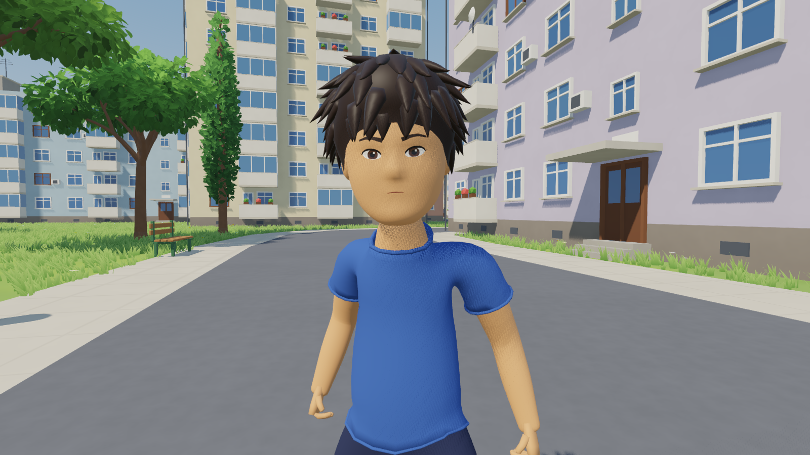
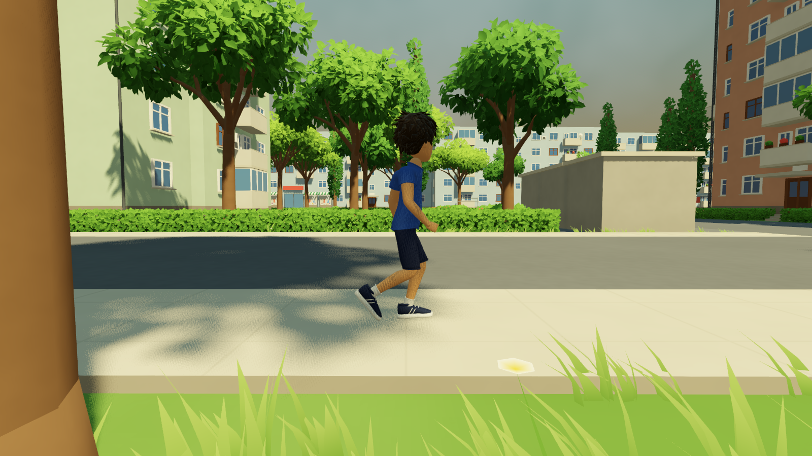
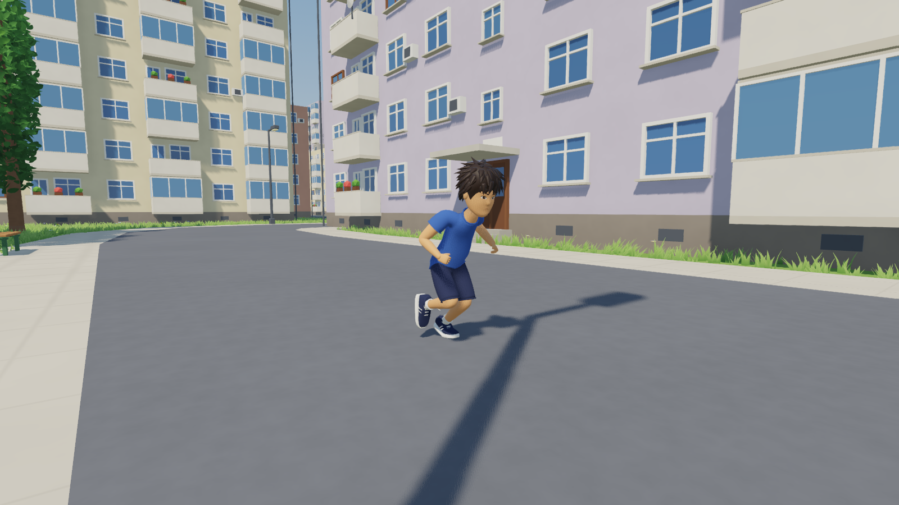
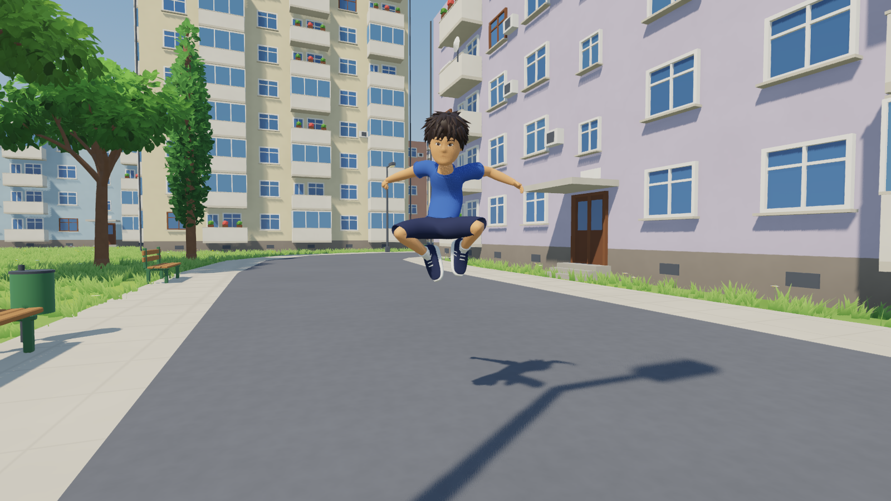
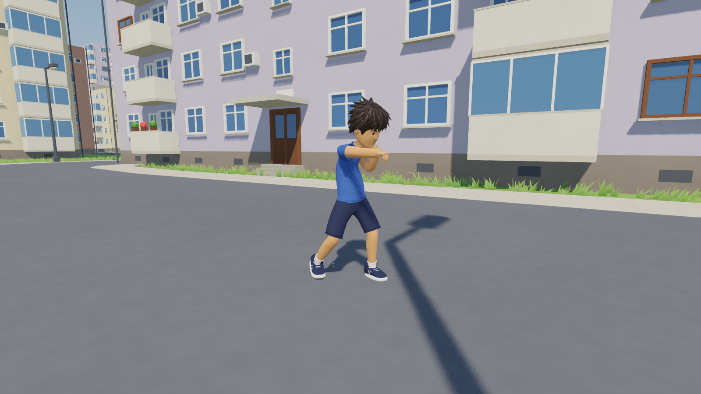
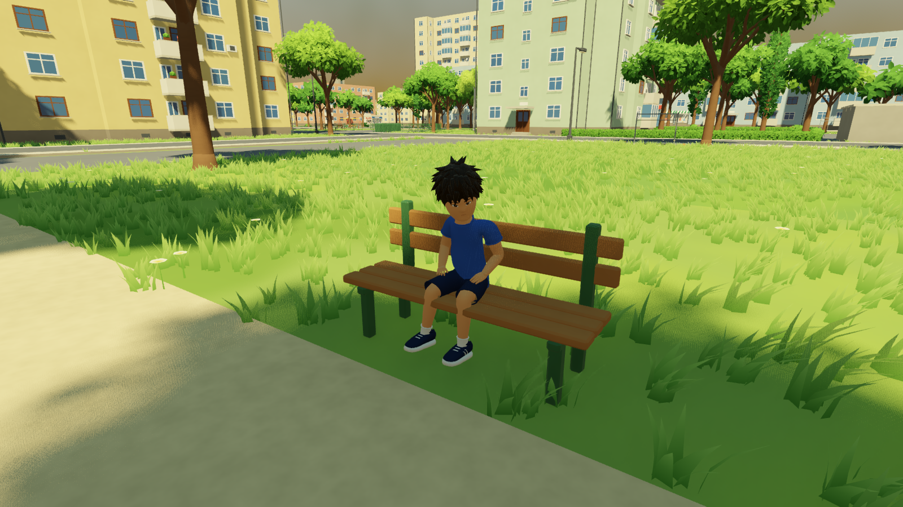
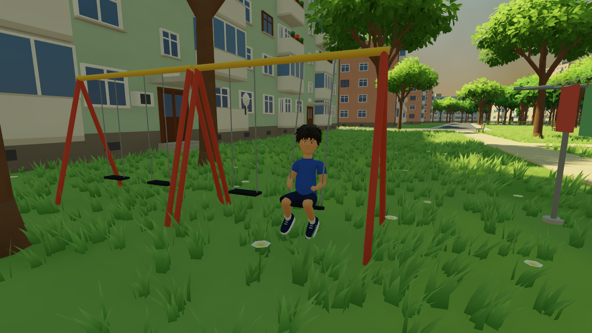
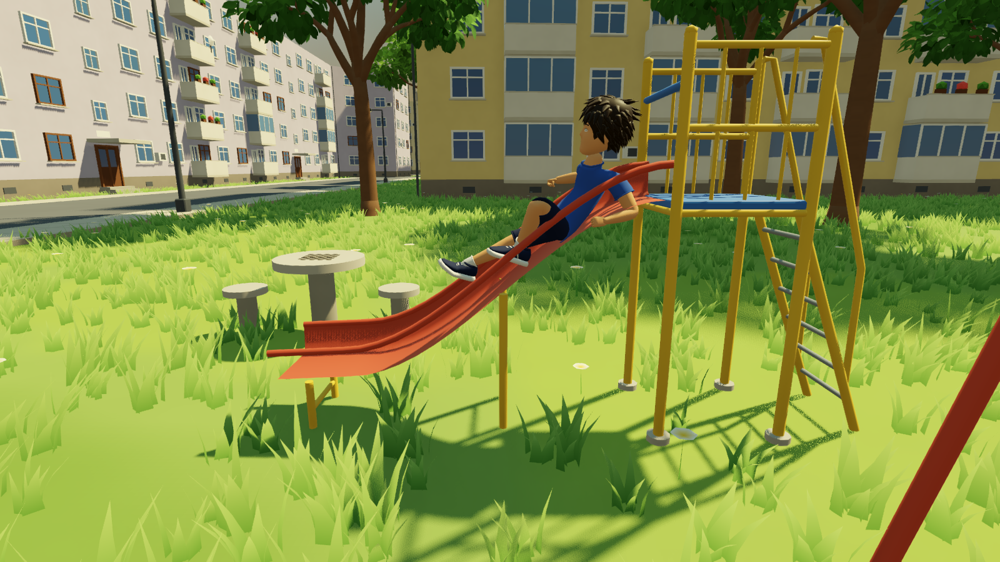

# The playable character (`game/characters/kid/`)



The boy from [the character sheet](../reference/character_sheet.png), about 1.5 m
tall, built by `blender/build_character.py` in layers, like a character with
an outfit system:

- **Base body**: one smooth, watertight mesh (Skin modifier + subdivision)
  skinned to the rig below with automatic weights. It is exported in pieces (`body_torso_upper`,
  `body_pelvis`, `body_upper_arms`, `body_thighs`, `body_ankles`,
  `body_feet`... and `body_base`) whose seams match exactly.
- **Head, face, hair, hands**: smooth separate meshes; spiky hair made of a
  cap plus ~120 pointed locks weighted to the hair bones.
- **Garments** (`garment_shirt`, `garment_shorts`, `garment_socks`,
  `garment_shoes`): separate meshes, each modelled from its own stick figure,
  cut open at the hems, given thickness and rolled edges, fitted to stay
  clear of the body and of the garments underneath, and skinned with weights
  taken from the body surface under them.

`kid.json` lists the garments, the body pieces each one hides, the default
outfit, the spring (hair) bones and the gait speeds. In the game
`player.wear([...])` shows a set of garments and hides the body pieces they
cover, so no skin can poke through clothes and new outfits or accessories
can be added later without touching the body.

## Rig

The skeleton has 56 joints: root, hips, a 3-bone spine, neck, head,
shoulders, arms, hands, thighs, shins, feet, toes, three hair bones, and
**fingers**: three bones for each finger and the thumb of each hand (15 a
hand), so hands can hold the swing chains, make a fist or point. Each
finger is weighted to its own chain with smooth crossfades at the knuckles.

The head has **11 face shapes** (blend shapes on `kid_head`): `blink_L`,
`blink_R`, `look_left`, `look_right`, `look_up`, `look_down`, `brows_up`,
`brows_frown`, `smile`, `sad` and `mouth_open`. They are made by moving the
eyelids, brows and mouth of the head mesh, so they keep working when the
character is redesigned as long as the new head has the same parts.

`kid.json` lists the finger bones, the face shapes, the **outfit slots**
(top, bottom, socks, shoes: `player.wear_item("garment_...")` swaps one
garment in its slot), the foot strike times of each gait and the clips that
loop.

## Animations

Animations come from Quaternius' [Universal Animation Library](https://quaternius.com/packs/universalanimationlibrary.html)
1 and 2 (CC0), retargeted onto the boy by `blender/retarget_ual.py`
(fingers included): each bone follows the source bone's motion from a rest
pose lined up with the source's, the hips move by the source's motion
scaled to his leg length, and every clip is set on the ground.
`python tools/get_animations.py` downloads the libraries.

43 clips:

* **Moving**: `idle`, `walk`, `jog`, `run`, `crouch_idle`, `crouch_walk`,
  `jump`, `fall`, `land`, `double_jump`, `climb_up`, `roll`. The walk, jog
  and run cycles are resampled to the same length (one second, two steps),
  so they blend in step.
* **Using things**: `sit_down`, `sit_idle`, `sit_up`, `interact`,
  `pick_up`, `push`, `throw`, `drink`, `carry_walk`, `slide_start`,
  `slide_loop`, `slide_exit`, `swing_pump`, `kick`.
* **Fighting**: `punch_jab`, `punch_cross`, `hit`.
* **Standing about**: `idle_arms`, `idle_lean`, `idle_call`, `nod`,
  `shake_head`, `scratch_head`, `look_back`, `wave`, `breathe_hard`.
* **Hand poses** for the fingers only: `hand_relaxed`, `hand_fist`,
  `hand_grip`, `hand_point`, `hand_open`.

`swing_pump`, `kick`, `wave`, `scratch_head`, `look_back`,
`breathe_hard` and the hand poses are made in `build_character.py`
(`procedural_clips`, `HAND_POSES`) from key poses, since the libraries have
no such clips.

## In the game

The player is split into parts (`game/scripts/player/`), so each can be
reused or replaced, and so a network peer or a mini-game can drive the boy:

| Part | What it does |
| --- | --- |
| `PlayerInput` | Reads keyboard, mouse and gamepad into an *intent* (move, run, sprint, crouch, jump, use, punch, photo, look). Nothing else reads the devices |
| `CameraRig` | The follow camera: a little lag (softer up and down, so kerbs do not jolt it), a shoulder offset, out of walls with its spring arm, wider when sprinting, closer when crouching, a dip on hard landings |
| `KidAnimator` | The AnimationTree built in code: a blend space of idle, walk, jog and run whose time scale matches the stride to the ground speed (no sliding feet), a crouch blend space, whole-body modes (sit, swing, slide, carry, lean...), one-shot actions over them, and a hand layer over the fingers only. Footstep events come from the gait's foot strikes |
| `FootPlacement` + `TwoBoneIK3D` | Feet on kerbs, steps and slopes: the hips drop to the lower foot, each leg reaches its ground, feet tilt to the slope |
| `LookAtModifier3D` | Chest, neck and head turn (a quarter, two fifths and three quarters) towards what he is looking at |
| `KidFace` | Blinks (sometimes twice), eyes following the look target, expressions (happy, grin, surprised, effort, sad, squint, tired, focused) |
| `KidPersonality` | Where he looks (something to use nearby, something that just happened, where the camera looks), fidgets after standing about a while (scratches his head, looks back, kicks at the ground, folds his arms...), gets tired from sprinting |
| `BodyDynamics` | Breathing, harder and faster after sprinting, and a settle of the chest on landing |

`scripts/player.gd` ties them together: walking, jogging (Shift), sprinting
(tap Shift twice or click the stick), a stop-and-turn on sharp changes of
direction, leaning into turns and speed changes, jump, double jump, falls
measured for a light or heavy landing, crouching, climbing low walls by
jumping at them, the punch combo, using things (`attach`, `detach`,
`hips_pin`: the clip's hips are held on a seat), carrying and throwing a
ball. Hair bounces on `SpringBoneSimulator3D`.

```python
import sys; sys.path.insert(0, r"<repo>/blender")
import build_character; build_character.run(r"<repo>")
build_character.preview(r"<repo>")      # optional: turnaround renders in renders/kid/
```

| Walk | Run | Double jump | Punch |
| --- | --- | --- | --- |
|  |  |  |  |

| On a bench | On a swing | Down the slide |
| --- | --- | --- |
|  |  |  |

The build also runs without Blender's window, with the `bpy` module from
pip (`pip install bpy`, Python 3.13): `python -c "import sys;
sys.path.insert(0, 'blender'); import build_character;
build_character.run('.')"`.
