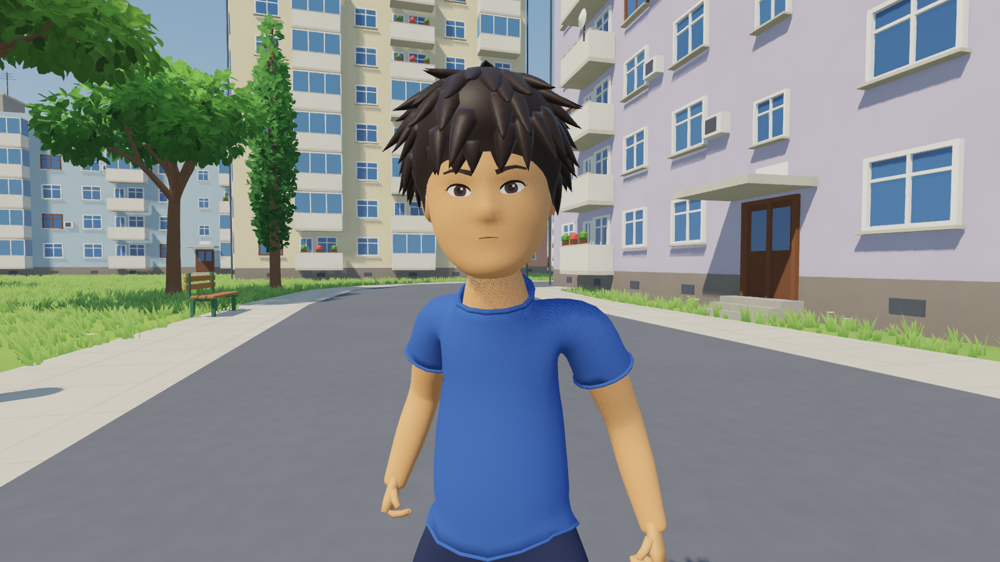
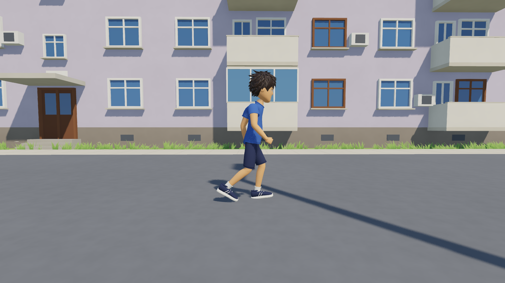
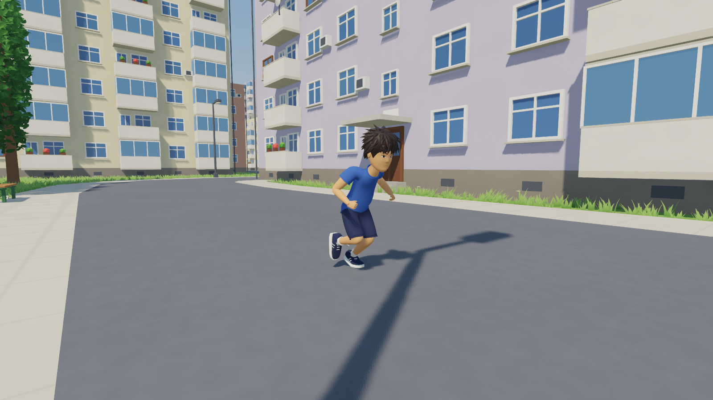
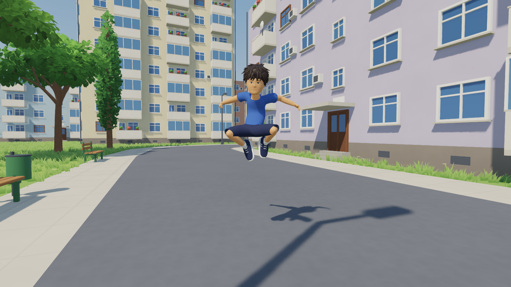
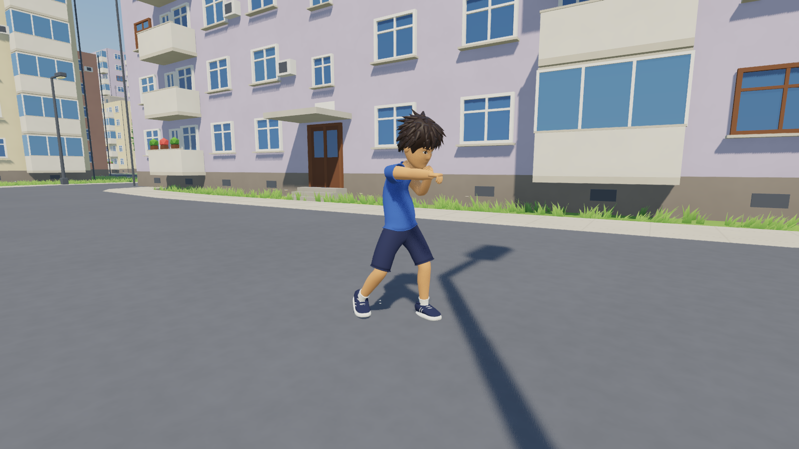

# The playable character (`game/characters/kid/`)



The boy from [the character sheet](../reference/character_sheet.png), about 1.5 m
tall, built by `blender/build_character.py` in layers, like a character with
an outfit system:

- **Base body**: one smooth, watertight mesh (Skin modifier + subdivision)
  skinned to a 26-bone rig (root, hips, 3-bone spine, neck, head, shoulders,
  arms, hands, fingers, thighs, shins, feet, toes and three hair bones) with
  automatic weights. It is exported in pieces (`body_torso_upper`,
  `body_pelvis`, `body_upper_arms`, `body_thighs`, `body_ankles`,
  `body_feet`... and `body_base`) whose seams match exactly.
- **Head, face, hair, hands**: smooth separate meshes; spiky hair made of a
  cap plus ~120 pointed locks weighted to the hair bones.
- **Garments** (`garment_shirt`, `garment_shorts`, `garment_socks`,
  `garment_shoes`): separate meshes, each modelled from its own stick figure,
  cut open at the hems, given thickness and rolled edges, fitted to stay
  clear of the body and of the garments underneath, and skinned with weights
  taken from the body surface under them.

`kid.json` lists the garments, the body pieces each one hides, the default
outfit, the spring (hair) bones and the gait speeds. In the game
`player.wear([...])` shows a set of garments and hides the body pieces they
cover, so no skin can poke through clothes and new outfits or accessories
can be added later without touching the body.

Animations come from Quaternius' [Universal Animation Library](https://quaternius.com/packs/universalanimationlibrary.html)
1 and 2 (CC0), animated for game characters, retargeted onto the boy by
`blender/retarget_ual.py`: each bone follows the source bone's motion from a
rest pose lined up with the source's, the hips move by the source's motion
scaled to his leg length, and every clip is set on the ground. Clips: `idle`,
`walk`, `run` (sprint), `jump`, `fall`, `land`, `double_jump` (a mid-air
flip), `crouch_idle`, `crouch_walk`, `punch_jab`, `punch_cross` and `hit`.
`python tools/get_animations.py` downloads the libraries.

`scripts/player.gd` plays them: walk, run and crouch-walk sped up to match
the ground speed (feet don't slide) and switched at the same point of the
stride, leaning into turns and speed changes, hair bouncing on
`SpringBoneSimulator3D`, jump, double jump, fall and landing, a crouch that
lowers the collision capsule (and waits for room to stand up), a jab–cross
punch combo, and `take_hit()` for a hit reaction. Its materials (`CH_*`) go
through the same material library as the world (skin, hair, cloth, eye).

```python
import sys; sys.path.insert(0, r"<repo>/blender")
import build_character; build_character.run(r"<repo>")
build_character.preview(r"<repo>")      # optional: turnaround renders in renders/kid/
```

| Walk | Run | Double jump | Punch |
| --- | --- | --- | --- |
|  |  |  |  |
