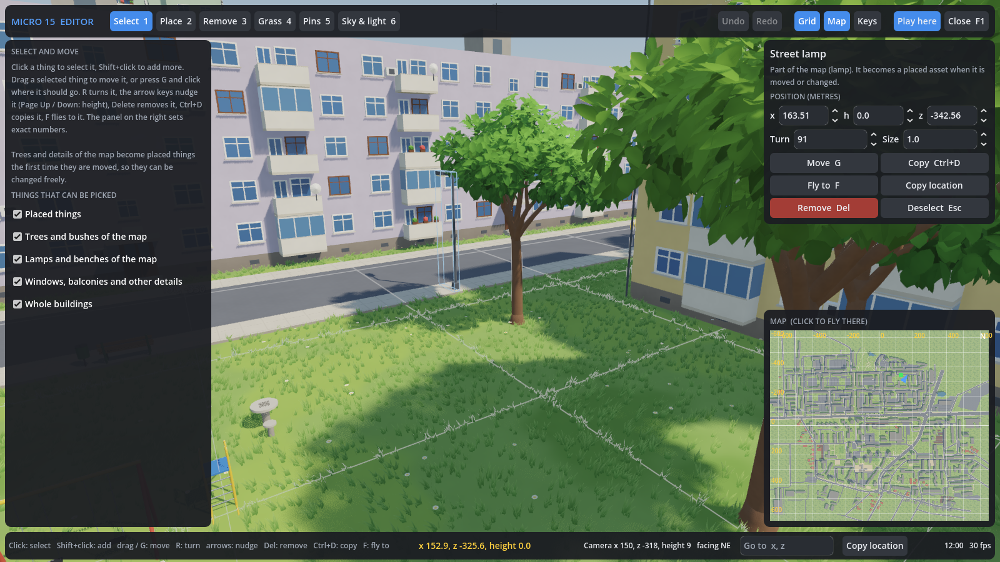
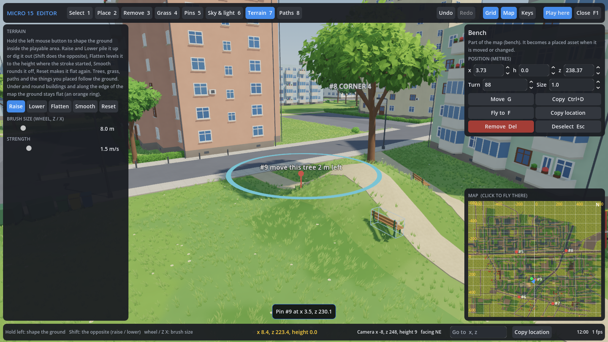
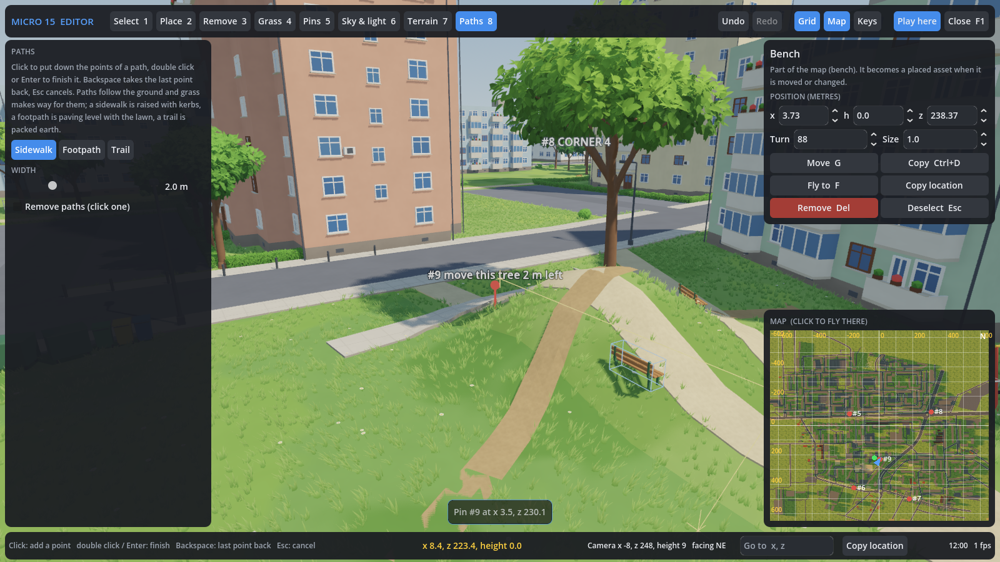

# The editor project and the map editor

## Scenes in the Godot editor

Open `game/` in Godot 4.7. Everything is a real scene that opens and can be
edited in the Godot editor:

* `levels/micro15/micro15.tscn` is the level, as nodes:
  * `WorldEnvironment` (`style/world_environment.tres`), `Sun` and
    `SunCycle`.
  * `Ground` and `Buildings`: the glTF scenes, styled by
    `scripts/styled_model.gd` (in the editor too).
  * `Details` and `Props` (`scripts/scatter.gd`): the repeated windows,
    balconies, trees and lamps, drawn with MultiMeshes and visible in the
    editor.
  * `Grass`.
  * `Terrain` and `Paths`: the ground's shape and the paths drawn with the
    map editor.
  * `Boundary`: the invisible wall round the playable area and the
    distant blocks beyond the map (see [the map](map.md)).
  * `Placed`: the things placed with the map editor, from
    `levels/micro15/placed.tscn`.
  * `InkOutline` (`style/ink_outline.tres`): hidden; F2 shows it for
    comparison.
  * The `Player`.
* `player/player.tscn` holds the collision capsule, the boy
  (`characters/kid/kid.glb`) and the camera on a spring arm.
  `scripts/player.gd` drives it. The inputs are in Project Settings → Input
  Map.
* `assets/*.tscn` is one scene per placeable thing, with collision
  ([the assets](assets.md)). `assets/details/*.tscn` holds the building
  details. Drag them into a level in the editor, or place them in the game
  with the map editor.

## Map editor (`scripts/admin.gd`, `scripts/editor/`)

The map editor is only there when the game runs from the Godot editor,
never in exported builds. **F1** opens it, and goes back to the game.

It has:

* a free camera;
* a tool bar along the top;
* the tool's panel on the left;
* the selection's inspector and the map on the right;
* the coordinates along the bottom.

The Keys button lists every shortcut.

| Tool (key) | What it does |
| --- | --- |
| Select (1) | Click anything to select it; Shift+click adds more. That covers placed things, the map's trees, bushes, lamps and benches, windows, balconies and other building details, and whole buildings. Drag a selected thing (or press G, then click) to move it. R turns it, the arrow keys nudge it (Page Up / Down: height), Delete removes it, Ctrl+D copies it and F flies to it. The inspector takes an exact position, turn and size. Map things become placed assets the first time they move. Buildings can be removed, not moved. |
| Place (2) | An asset browser with a picture of every asset, search, and categories (Plants, Street, Shops, Play, Building). Wall things (gas pipe, plates, wall lamp, shop window) have their back at the origin, so they sit flat against a wall. Click to place. The wheel or R turns, Shift+wheel or Z / X sizes. It has a random turn and size, and a 0.5 m grid snap. |
| Remove (3) | A click removes what the red box shows, anything including whole buildings. Shift+drag removes everything ticked inside the ring: placed things, trees and bushes, lamps and benches, building details. One button removes the map things standing on roads. |
| Grass (4) | Hold the left button to grow 3D grass; hold Shift (or tick Clear) to clear it. |
| Pins (5) | Click to drop a numbered pin with a note. The pins can be copied as text, to point at places when asking for changes. The pins noted CORNER 1 to CORNER 4 set the playable area ([the map](map.md)). |
| Sky & light (6) | Presets and sliders. The presets are summer noon, morning, golden hour, sunset, blue hour, night, overcast, foggy morning, autumn, winter and storm. The sliders cover the time, season, sun strength and colour, soft shadows, sky and horizon colours, clouds, shade light, fog, exposure, contrast, colour and glow. "Save as the level's look" keeps the look. |
| Terrain (7) | Hold the left button to shape the ground inside the playable area: Raise, Lower (Shift does the opposite), Flatten to the height where the stroke started, Smooth, or Reset to flat. The size goes up to 40 m and the strength up to 6 m a second. Trees, lamps, benches, grass, paths and the things you placed move with the ground. It stays flat under and round buildings and along the edge of the map, where the ring turns orange. |
| Paths (8) | Click the points of a path, then double click or press Enter to finish it. Backspace takes the last point back and Esc cancels. A sidewalk is raised paving with kerbs (2 m), a footpath is paving level with the lawn (1.6 m), and a trail is packed earth (1.2 m); the width can be changed. Paths follow the ground and grass makes way for them. With "Remove paths" ticked, a click removes the path under the mouse. |

| Shaping the ground | Drawing paths |
| --- | --- |
|  |  |

**Camera.** Hold the right mouse button and move the mouse to look. WASD
flies (Shift is faster); Q / E move down and up while looking. The wheel
moves forwards; with the right button held it sets the flying speed. **P**
plays from where the camera looks.

**Coordinates** are metres from the middle of the map, with x to the east
and z to the south (north is -z).

* The status bar shows the point under the mouse and the camera.
* Ctrl+C or Copy location copies the point (or the selection) as
  `x 357.6, z 18.5`, and Go to flies there.
* **H** draws a 10 m / 100 m grid on the ground with labelled crossings.
* **M** shows the map; click it to fly there.
* In the game, **F4** shows the player's position.

Ctrl+Z / Ctrl+Y undo and redo every change. F2 / F3 turn the old ink lines
and the 3D grass on and off. F12 saves a screenshot.

## What the editor saves (`game/levels/micro15/`)

Everything is saved as it changes, and read when the level loads.
Deleting a file undoes all of its changes.

| File | What it holds |
| --- | --- |
| `placed.tscn` | Things you placed or moved, as normal nodes you can also edit in the Godot editor |
| `removed_props.json` | Map trees, bushes, lamps and benches you removed |
| `removed_details.json` | Building details you removed |
| `removed_buildings.json` | Whole buildings you removed |
| `grass_paint.json` | Grass you grew or cleared |
| `pins.json` | Your pins and their notes |
| `lighting.json` | The level's look, from Sky & light |
| `terrain.json` | The ground's shape: the height of every changed point of the 2 m grid |
| `paths.json` | The paths: type, width and points |

These files are your work, so they are kept in the repository. The map
rebuild in [the map](map.md) never touches them.
