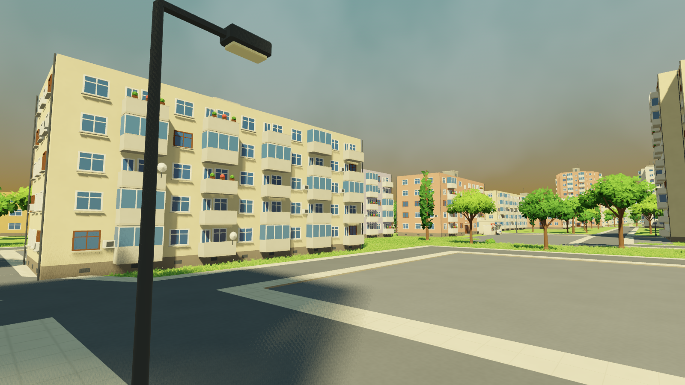

# The map (`game/levels/micro15/`)


The main scene, `levels/micro15/micro15.tscn`, is the Micro 15
neighbourhood in full 3D, built by `blender/build_map.py` from the
OpenStreetMap extract (`reference/micro15_osm.json`). The player can walk
the playable area set by the corner pins; the rest of the neighbourhood is
drawn round it, so the streets and blocks carry on past the edge.

## The playable area

The four map editor pins noted **CORNER 1** to **CORNER 4**
(`levels/micro15/pins.json`) mark the corners of the playable area.
`tools/make_play_area.py` pushes each side out just far enough to take in
the streets the corners stand beside, with their sidewalks and a 4 m margin,
so the edge never runs down the middle of a street. Today these are
Strada Careiului, Bulevardul Lalelei, Strada Oituz and Strada Dariu Pop. It
writes `levels/micro15/play_area.json`:

```json
{"corners": [[x, z], ...],   // the pins
 "polygon": [[x, z], ...],   // the playable area
 "roads":   ["Strada Careiului", ...]}
```

The area is about 24 hectares, with sides of 530, 342, 634 and 495 m, and
holds 54 of the map's 343 buildings.

Inside the area the ground is cut into 32 m chunks (`g_<i>_<j>` in
`ground.glb`) diced into 2 m cells, so the terrain tool can shape it; the
ground outside is one mesh, `ground_outer`.

## The edge (`scripts/boundary.gd`)



The `Boundary` node puts an invisible wall, 80 m high, just outside every
side of the area, so the player can neither walk nor jump out, while the
mapped streets and blocks carry on behind it. Beyond the mapped
neighbourhood (about 600 m from the middle) a ring of distant blocks of
flats (`shaders/boundary.gdshader`) reaches out to 1.8 km. They and the
outer lawn fade into the sky's horizon colour with distance, so the town
seems to go on to the horizon at any time of day. The wall reads
`play_area.json`, so it moves with the corner pins; the distant blocks are
drawn in the Godot editor too.

The self-test (`-- --selftest`) runs and jumps the player at the edge and
checks they are still inside.

## How the map is built

* **Buildings** are exported as light shells (`buildings.glb`). Their
  repeated details are modelled once in `details.glb` and placed from
  `details.json`: windows, balcony doors, open and enclosed balconies,
  entrances, curtains, AC units, dishes, pots, drainpipes, roof huts,
  antennas, vents, garage doors and shop fronts. Godot draws each type with a
  MultiMesh per 96 m cell (`scripts/scatter.gd`), and small details stop
  drawing beyond 120 to 450 m.
* **Trees and street furniture** work the same way (`props.glb`,
  `props.json`). Trees switch to a lighter "far" version past 70 m.
* **3D grass** is built in chunks around the camera as you walk, and freed
  behind you (`scripts/grass_field.gd`, mask `grass_mask.png`).
* **Collision.** Buildings, kerbs, tree trunks and lamp posts are solid.
  Kerbs are low enough to walk up.
* **Terrain and paths.** `scripts/terrain.gd` shapes the ground chunks from
  `terrain.json`, keeping the ground flat under buildings (from
  `footprints.json`) and along the edge. The map's trees, lamps and benches,
  the grass and the paths follow it. `scripts/paths.gd` builds the
  sidewalks, footpaths and trails in `paths.json`.
* **Your edits** made with the map editor are separate files, read when the
  level loads: `placed.tscn`, `removed_props.json`, `removed_details.json`,
  `removed_buildings.json`, `grass_paint.json`, `pins.json`,
  `lighting.json`, `terrain.json` and `paths.json` (see
  [the editor](editor.md)).

## Rebuilding

After moving a corner pin, or changing `build_map.py`:

```
python tools/make_play_area.py
```

Then in Blender's Python console, with `blender/micro15_world.blend` open:

```python
import sys; sys.path.insert(0, r"<repo>/blender")
import build_map; build_map.run(r"<repo>")      # or part="buildings" / "ground" / "details" / "props"
```

Then:

```
python tools/make_grass_mask.py
```

`props` reads the tree, bush, lamp and bench positions from
`micro15_world.blend`, so run it with that file open. After moving a corner
pin, rebuild at least `ground`, since the shapeable chunks follow the area.
The Boundary updates by itself the next time the level opens, and the
ground's shape (`terrain.json`) and the paths survive a rebuild.

## The 3D corner test (`game/levels/corner/`)


The first walkable 3D corner of Micro 15, around Aleea Constelației and
Aleea Proiectantului, which set the look for the whole map. It is kept as a
small test scene: open `levels/corner/corner.tscn` and press F6. It is built
by `blender/build_corner_3d.py` (`build_corner_3d.run(r"<repo>")`) and its
grass mask by `python tools/make_grass_mask.py corner`.
