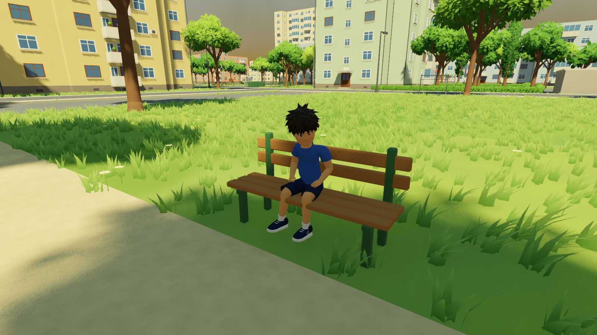
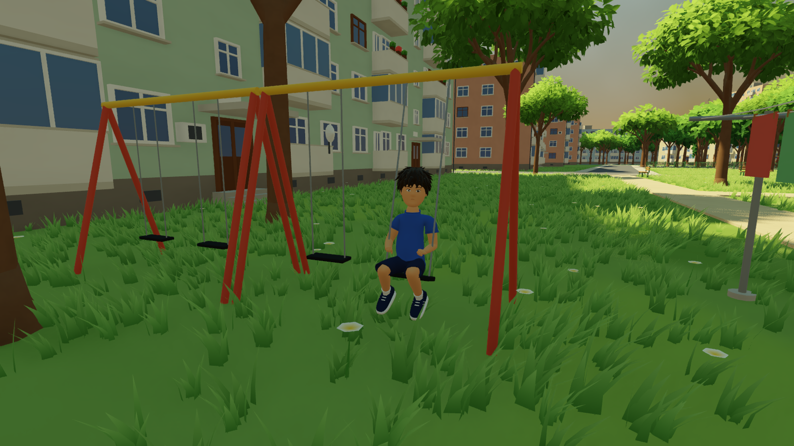
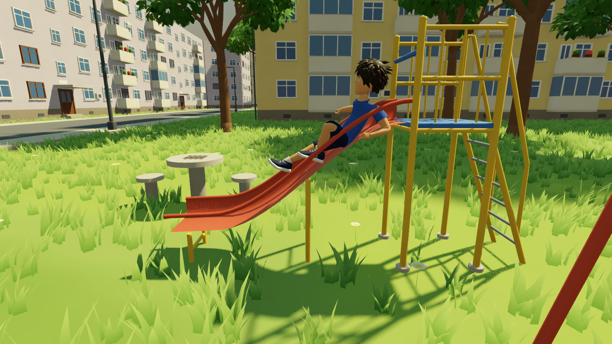

# Playing (`game/scripts/interact/`, `game/scripts/ui/`, `game/scripts/audio/`)

What there is to do in Micro 15 and how each part works. Controls are in
[the README](../README.md#playing).

| On the bench | Pumping the swing | Down the slide |
| --- | --- | --- |
|  |  |  |

## Things to use

Walk up to something and its prompt appears at the bottom of the screen
(`E`, or X on a pad). Everything usable is an **Interactable**
(`scripts/interact/interactable.gd`): it says what the button does
(`prompt_for`), and an interaction that holds the boy (a seat, a swing) gets
his input every frame (`drive`) until he gets off. The same contract will
carry co-op and mini-games later.

`InteractionDirector` gives every usable thing its interactable when the
level starts, for the things you placed with the map editor and for the
map's own benches. Nothing is saved into the level, so the editor's files
stay exactly as you left them, and things placed while the game runs work
at once.

| Thing | What he does |
| --- | --- |
| Benches (placed and the map's 157), chess table stools, picnic tables | Sits down, sits (his hips held on the seat), gets up when you press use or walk off |
| Swings | Swing seat and chains hang from the top bar as a pendulum. Push forward and back in time with it to go higher, like on a real one; let go and it dies down. Jump at the front of a big swing to jump off |
| Seesaw | Sits on the low end; jump pushes off, and his end comes back down with a bump |
| Slide | Up the ladder, sits at the top, down the chute (faster on the steep part) and off the end |
| Carpet beater | Leans on the post |
| Kiosk, ice cream freezer, drinks fridge, fruit stand, corner shop | Buys the next thing on its list for bottle caps (gum, seeds, a can of juice, an ice cream...). Shops keep hours; the kiosk is NON STOP |
| Ball | Kick it (punch button next to it), pick it up (use), throw it (use or punch). There is one at each playground, and one by every football goal and basketball hoop, which count goals and baskets |

He climbs low walls and ledges (0.45 to 1.15 m) by jumping at them.

## Bottle caps

Every kid in a block yard collected bottle caps. Sixty lie where kids drop
things: by benches, playgrounds, kiosks and shops. They glint now and then
so they can be spotted, and walking over one picks it up. They are the
game's pocket money for the shops. Each cap has its own id (from where it
lies), so a found cap stays found.

## Memories

A pin placed with the map editor whose note starts with `MEMORY:` becomes a
memory: a few motes of light hang there until it is read. Use it to read
it. The first line after `MEMORY:` is the title, the rest is the story:

```
MEMORY: The summer of the broken window
We played football against the garages until...
```

Read memories are listed in the journal (hold Tab). There are none in the
game yet: they are yours to write.

## Photo mode

`V` (Back on a pad) holds the game still and frees the camera within 8 m of
the boy. Mouse or right stick aims, WASD moves, Space and Ctrl rise and
sink, the wheel zooms, Q and E tilt, 1 to 5 change his expression, F hides
him, H hides the hints, and a click takes the picture. Photos go to
`user://photos/` (on Windows `%APPDATA%\Godot\app_userdata\Micro 15\photos`)
and are counted in the journal.

## The journal, the pause menu and saving

Hold **Tab** for the journal: caps, photos, time played and the memories
found. **Esc** pauses: Resume, Settings (look speed for mouse and stick,
invert, field of view, volumes, prompts, camera dips on landings),
Controls, Quit.

`scripts/save.gd` (autoload `Save`) keeps caps, memories, photos, what was
bought, the play time and the settings in `user://save.json`. Writes are
batched (a second after a change, and on quit). The self-test and the
preview shots never touch it.

## Sound

There are no recordings yet: `python tools/make_sounds.py` synthesises
every sound into `game/audio/` from noise, filters and oscillators (fixed
seeds, so it gives the same files every time). A real recording can replace
any file under the same name.

* **Footsteps** by what he walks on (`scripts/world/surfaces.gd`): asphalt,
  paving, concrete, grass, dirt, gravel, sand, wood, metal, rubber; quieter
  when crouching, heavier on landings. The surface comes from what was hit
  (placed assets), the paths drawn in the editor, the lawn, or the ground's
  material under his feet.
* **Ambience**: by day wind in the trees, the city's low rumble, sparrows
  and pigeons; at night crickets, crossfaded by the time of day.
* **Unseen neighbours** (no people in the world, but the yard is lived in):
  somebody beating a carpet, a ball against a wall, a stairwell door, a
  window shutting, somewhere 10 to 45 m away at a building, at the hours
  they would happen.
* Effects: the swing's chains creaking, the seesaw's bump, the ball, caps,
  coins at a kiosk, a whistle for a goal, the camera shutter.

Two buses, Ambience and Effects, follow the volume settings.

## Night

At night (`SunCycle`, F1 → Lighting, or the time shots) about four in ten
windows light up, each its own warmth, a few flickering blue with a
television; the street lamps' glass glows and the lamps near the camera
light the ground (a pool of ten lights moved to the nearest lamps); stars
come out and the moon stands where the moonlight comes from.

## Wind

One wind (`scripts/world/world_state.gd`) wanders in direction and
strength, with gusts, and both the grass and the tree crowns read it
(shader global `wind`), so they move together. Grass bends away from the
boy's feet (`player_position`).

## Checking it

* `-- --selftest` ends by using one of everything (a bench, a swing pumped
  for six seconds, the slide, the seesaw, a shop, a ball, a cap, the pause
  menu and photo mode) and prints what happened; `-- --selftest
  interactions` runs only that part.
* `-- --shots kid_bench kid_swing kid_slide` renders the boy using them.
* `-- --perf` walks a camera round the play area at a child's eye height
  and once over it, and prints the average and 95th percentile frame time
  and the slowest places; every frame goes to `user://perf.csv`. Run it on
  the PC that should run the game.
